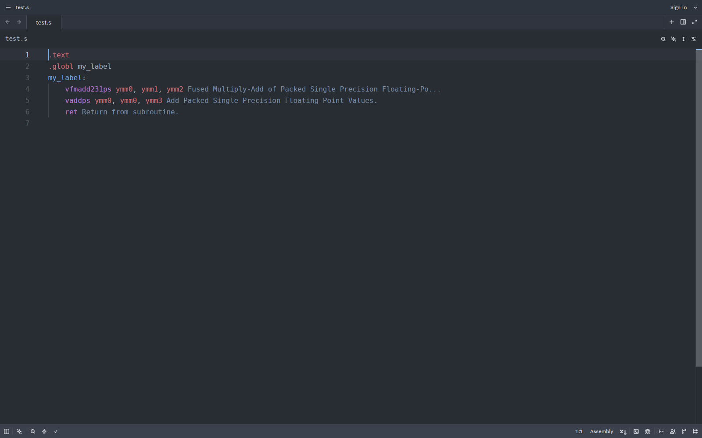
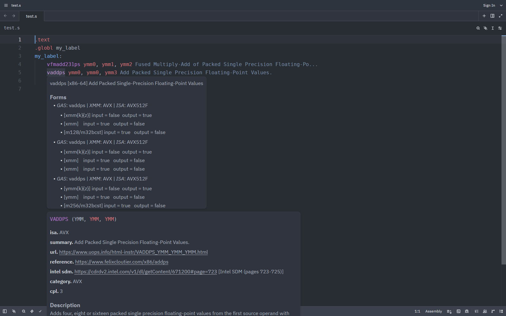
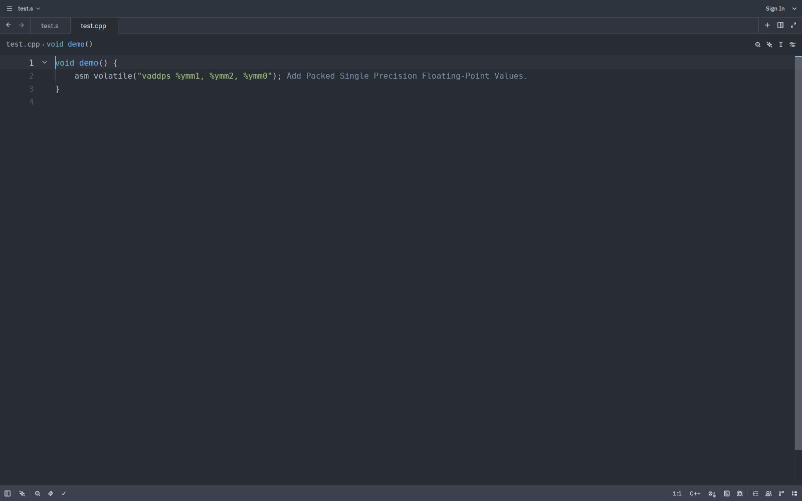
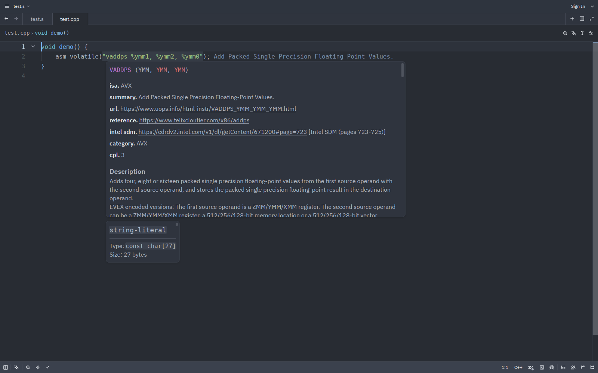

# Asm & Intrinsics Reference






A Zed extension, ID `asm-intrinsics-lsp`, that starts `simdref-lsp` for Assembly, PTX, C, and C++ buffers. The server shows a one-line summary at the end of each assembly line. This summary shows in `.s` and `.ptx` files and in inline `asm(...)` strings in C and C++. Hover on an instruction or SIMD intrinsic to show the full simdref page from the local catalog, with no network.

To get hints in `.s` files, install the Zed `assembly` extension. The extension registers a PTX language for `.ptx` files.

Zed has no CUDA or NASM language, so `.nasm` files get no hints. `.cu` and `.cuh` files open as C++. Inline `asm(...)` in them gets hints, PTX included.

## Install

The extension is not on the Zed extension registry. Use the dev install.

Zed must have this setting in `settings.json`:

```json
"inlay_hints": {"enabled": true}
```

The extension installs the newest simdref.

## Settings

The extension has no settings of its own. Zed must have `inlay_hints.enabled` set to `true` for the hints to show. Zed has no inlay-hint length cap, so the full one-line summary shows.

## Auto-update

The extension upgrades the simdref copy it installed once a day. The daily check runs at language-server start. It takes about 0.4 s, and about 14 s on the day a new simdref version downloads its catalog. A stalled download can stretch that to about 8 minutes: uv retries each HTTP read, each read can take up to 120 s (UV_HTTP_TIMEOUT), and simdref's catalog download gives up after 120 s.

A new simdref version takes effect at the next server start. Run the `editor: restart language server` command to start the new version sooner.

## Auto-install

The extension looks for `simdref-lsp` on the `PATH` first. If it finds none, it downloads the `uv` release from `astral-sh/uv` and checks it against the sha256 pin in the code. It then installs simdref and its catalog. The first start downloads the catalog, 589 MB for the data-v0.0.13 release. All files stay in the extension work directory of Zed.

## Manual install

Run these commands, then start Zed again:

```sh
uv tool install simdref
isa update
```

`pip install simdref` also works. Run `isa update` after it. Instructions: https://github.com/simd-labs/simdref

If the install stops with an error, the language server status menu in Zed shows the cause. The file `install.log` in the extension work directory has the arguments, environment, exit status, stdout, and stderr of each command the extension runs. Open it first.

## Development

In Zed, run `zed: install dev extension` and select this directory.

## Troubleshooting

The extension uses a `simdref-lsp` on the `PATH`. Upgrade simdref with `uv tool upgrade simdref` or remove it from the `PATH`.

## License

GPL-3.0-or-later, the same license as simdref. See `LICENSE`.
